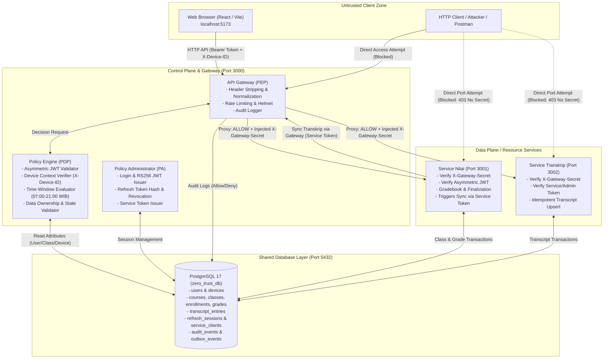
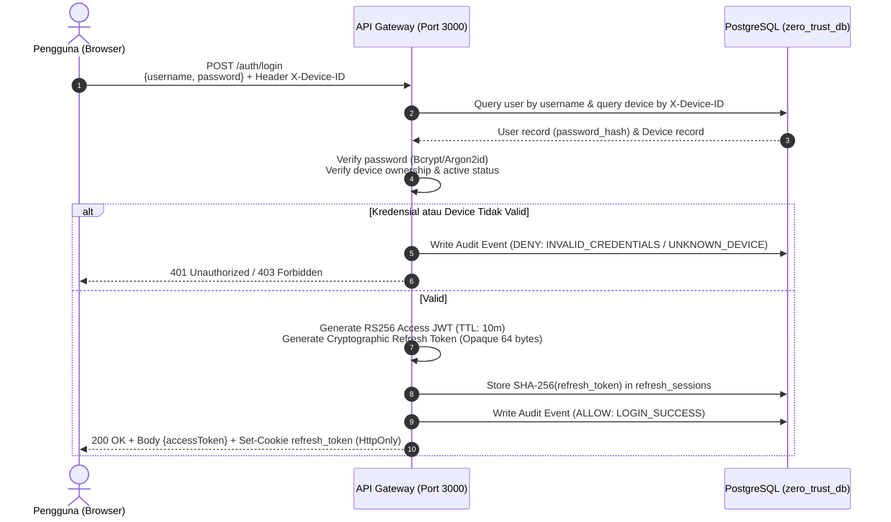
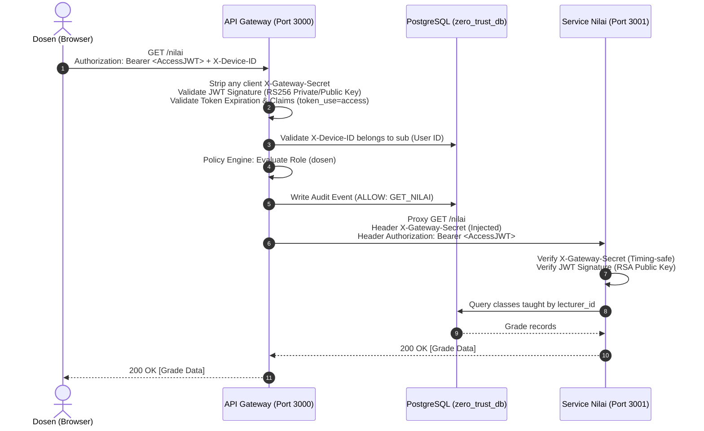
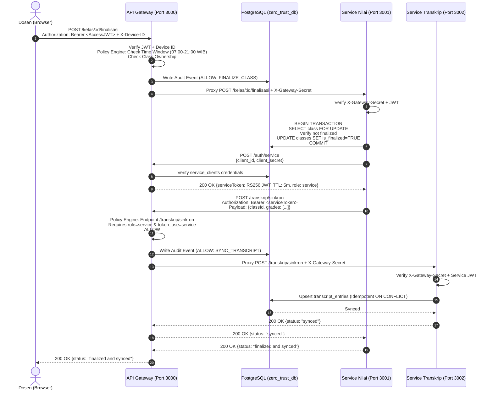

# Architecture Design: Zero Trust Academic Records ("NILAI")

## 1. Ikhtisar Arsitektur NIST SP 800-207

Arsitektur aplikasi dibangun berdasarkan panduan formal **NIST SP 800-207 (Zero Trust Architecture)**. Sistem memisahkan secara tegas antara **Control Plane** (Policy Enforcement Point & Policy Decision Point) dan **Data Plane** (Resource Services).

---

## 2. Komponen & Alokasi Port

### 1. API Gateway / PEP (Port 3000)
- **Peran NIST SP 800-207**: *Policy Enforcement Point (PEP)* dan memuat *Policy Decision Point (PDP)* & *Policy Administrator (PA)*.
- **Tanggung Jawab**:
  - Satu-satunya titik masuk publik bagi antarmuka pengguna (Frontend/Client).
  - Autentikasi pengguna (`/auth/login`, `/auth/refresh`, `/auth/logout`) dan penerbitan service token (`/auth/service`).
  - Pembuatan access token JWT ditandatangani menggunakan algoritma asimetris **RS256** (Private Key RSA 2048-bit).
  - Sanitasi request masuk: secara paksa menghapus header `X-Gateway-Secret` yang dikirim oleh client untuk mencegah peniruan identitas internal gateway.
  - Memeriksa header wajib `X-Device-ID` dan memvalidasi kepemilikan perangkat di tabel `devices`.
  - Mengevaluasi kebijakan otorisasi kontekstual: peran (Role), kepemilikan data (NIM/Kelas), status final kelas, dan jam akses operasional (07:00–21:00 Asia/Jakarta).
  - Pencatatan seluruh keputusan evaluasi (*allow* maupun *deny*) ke tabel `audit_events`.
  - Jika keputusan adalah `ALLOW`, menyuntikkan header rahasia `X-Gateway-Secret` dari environment server, lalu meneruskan request ke target service internal (`http-proxy-middleware`).

### 2. Service Nilai (Port 3001)
- **Peran NIST SP 800-207**: *Resource Service*.
- **Tanggung Jawab**:
  - Menyediakan endpoint baca (`GET /nilai`) dan ubah nilai (`PUT /nilai/:id`).
  - Menyediakan endpoint finalisasi kelas (`POST /kelas/:id/finalisasi`).
  - **Pertahanan Mandiri**: Setiap request yang masuk diperiksa:
    1. Keberadaan dan validitas `X-Gateway-Secret` via *timing-safe comparison*.
    2. Validitas kriptografis JWT menggunakan **Public Key** RSA (menolak request langsung walau secret diketahui jika tanpa token valid).
  - Melakukan finalisasi dalam transaksi atomik PostgreSQL: mengunci baris kelas, mengubah status menjadi final, mencatat log outbox/sinkronisasi.
  - Memperoleh service token dari Gateway melalui `POST /auth/service` menggunakan client credentials internal, lalu memanggil `POST /transkrip/sinkron` **melalui Gateway (port 3000)**, bukan direct URL port 3002.

### 3. Service Transkrip (Port 3002)
- **Peran NIST SP 800-207**: *Resource Service*.
- **Tanggung Jawab**:
  - Menyediakan endpoint transkrip akademik (`GET /transkrip/:nim`).
  - Menyediakan endpoint sinkronisasi transkrip (`POST /transkrip/sinkron`).
  - **Pertahanan Mandiri**: Memverifikasi `X-Gateway-Secret` dan Public Key JWT.
  - Endpoint `/transkrip/sinkron` **hanya** menerima token dengan `role=service` dan `sub=grades-service`. Permintaan yang membawa token pengguna umum (mahasiswa, dosen, bahkan admin) ditolak 403.
  - Implementasi operasi idempoten: request sinkronisasi berulang untuk kelas/mahasiswa yang sama memperbarui data transkrip tanpa membuat duplikasi entri (`ON CONFLICT (student_id, class_id) DO UPDATE`).

### 4. Database Layer (PostgreSQL 17 Lokal, Port 5432)
- Database bersama `zero_trust_db` menyimpan data pengguna, perangkat, perkuliahan, nilai, transkrip, sesi refresh token (hash), kredensial service client, dan log audit.
- Akses dilakukan dengan parameterized SQL untuk pencegahan total terhadap serangan SQL Injection.

### 5. Frontend Client ("NILAI", Port 5173)
- Single Page Application (SPA) berbasis React 19 + TypeScript + Vite.
- Tidak menyimpan token di `localStorage` (mencegah pencurian XSS). Access token disimpan dalam memory runtime; refresh token dikelola via cookie HttpOnly dengan proteksi CSRF.

---

## 3. Diagram Alur Permintaan (Sequence Diagrams)

### Alur 1: Autentikasi Pengguna & Penerbitan Token

### Alur 2: Akses Data Nilai oleh Dosen (Otorisasi Kontekstual & Proxy)

### Alur 3: Finalisasi Nilai Kelas & Sinkronisasi Antar-Service

